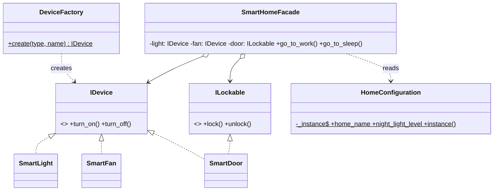

# Smart Home Mini (Python)

Chạy demo: `python smart_home.py` — Chạy kiểm thử: `python -m unittest -v`

## UML

## Vị trí sử dụng pattern và lợi ích

| Pattern | Vị trí | Lợi ích |
|---|---|---|
| Factory | `DeviceFactory.create` | Client không gọi constructor cụ thể, chỉ biết `IDevice` |
| Singleton | `HomeConfiguration.instance()` | Một cấu hình dùng chung, nhất quán toàn ứng dụng |
| Facade | `SmartHomeFacade` | Gọi `go_to_work()` / `go_to_sleep()` thay vì từng thiết bị |

**Hạn chế:** Facade gắn cứng 3 thiết bị (đèn, quạt, cửa) và `HomeConfiguration` là trạng thái toàn cục nên khó unit test, khó mở rộng (thêm camera phải sửa Facade).

## Phân tích (Phần A, C, D)

- Abstraction chung: `IDevice`; hành vi riêng của cửa: `ILockable`; thành phần tạo thiết bị: `DeviceFactory`.
- Dữ liệu thuộc cấu hình chung: `home_name`, `night_light_level`.
- Facade giữ: `light`, `fan` (IDevice), `door` (ILockable) và đọc `HomeConfiguration`.
- Factory che giấu gì? Việc chọn lớp cụ thể. Thêm `SmartCamera`: tạo lớp mới + thêm 1 dòng vào `_registry` (+ sửa Facade nếu cần chế độ dùng camera).
- Constructor Singleton: private (trong Python dùng quy ước, truy cập qua `instance()`); `sealed` ngăn kế thừa làm sinh ra thể hiện thứ hai (Python không có `sealed`, dùng quy ước/`__init_subclass__`).
- Singleton khó test vì trạng thái toàn cục tồn tại giữa các test và khó thay bằng mock.
- Có DI `AddSingleton` thì không bắt buộc tự cài Singleton: container quản lý vòng đời, dễ thay thế khi test.

## Phần G: Trả lời ngắn

1. Factory che giấu quyết định *tạo lớp cụ thể nào* từ chuỗi loại thiết bị.
2. Singleton đảm bảo chỉ có một thể hiện duy nhất; rủi ro: trạng thái toàn cục, phụ thuộc ngầm, khó test.
3. Factory nhằm *tạo đối tượng*; Facade nhằm *đơn giản hóa việc dùng* nhiều đối tượng qua một giao diện.
4. Không có Facade, client phải biết thiết bị nào cần thao tác, thứ tự các bước, cửa cần `lock()`, và phải tự đọc `NightLightLevel` từ cấu hình.

## Kết quả kiểm thử

T1–T5 trong `test_smart_home.py`.
